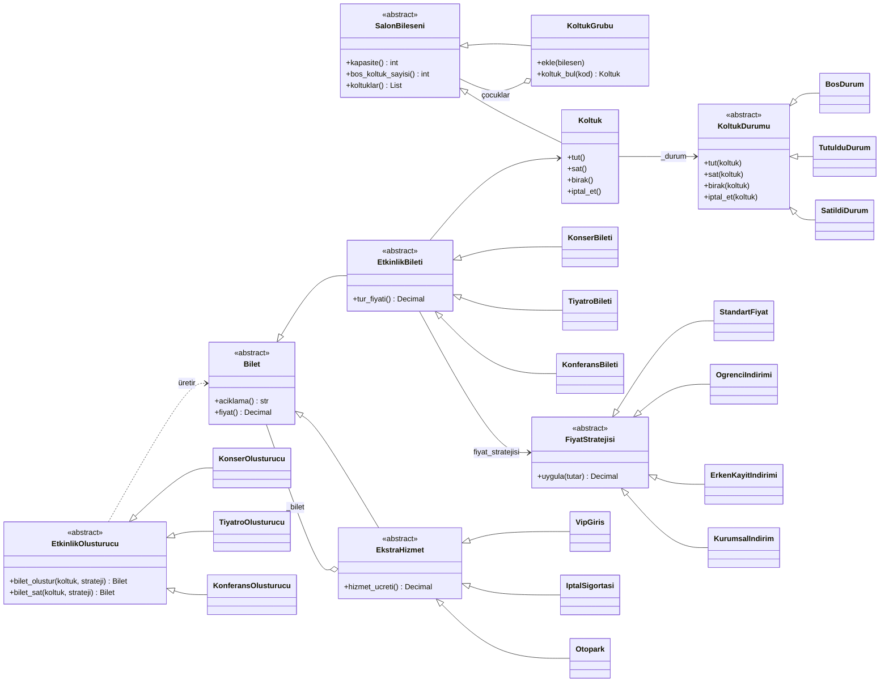

# Etkinlik Bilet Satış ve Rezervasyon Sistemi

Konser, tiyatro ve konferans gibi etkinlikler için koltuk seçimi, fiyatlandırma ve
rezervasyon yapılabilen bir sistem. Yazılım Tasarım Kalıpları dersi dönem projesidir.

Sistem beş GoF tasarım kalıbıyla geliştirilmiştir: yaratımsal grupta **Factory Method**,
yapısal grupta **Composite** ve **Decorator**, davranışsal grupta **Strategy** ve **State**.
Kalıplar çerçeve veya kütüphane desteği olmadan elle yazılmış, arayüzler `abc.ABC` ile
açıkça tanımlanmıştır.

> Durum: İlk geliştirme sürümü. Beş kalıp çalışır ve testlidir; kullanıcı arayüzü
> yerine kalıpları gösteren bir demo programı vardır.

## Hızlı başlangıç

```bash
python3 main.py              # demoyu çalıştırır
python3 -m unittest -v       # 36 testi çalıştırır
```

Gereksinim: Python 3.9 veya üstü. Ek paket gerekmez.

- Ayrıntılı kurulum: [docs/KURULUM.md](docs/KURULUM.md)
- Testler ve beklenen sonuçlar: [docs/TEST.md](docs/TEST.md)

## Kalıp haritası

| Kalıp | Grup | Çözdüğü problem | Rol → Sınıf | Dosya |
| --- | --- | --- | --- | --- |
| **Factory Method** | Yaratımsal | Konser, tiyatro ve konferans biletlerinin fiyat kuralları farklı. Satış kodu somut bilet sınıflarını bilmeden doğru bileti üretmeli. | Product → `Bilet`<br>ConcreteProduct → `KonserBileti`, `TiyatroBileti`, `KonferansBileti`<br>Creator → `EtkinlikOlusturucu`<br>ConcreteCreator → `KonserOlusturucu`, `TiyatroOlusturucu`, `KonferansOlusturucu` | `etkinlik/bilet.py`<br>`etkinlik/olusturucu.py` |
| **Composite** | Yapısal | Salon → blok → sıra → koltuk ağacında kapasite ve boş koltuk sorusu her seviyeye aynı şekilde sorulabilmeli. | Component → `SalonBileseni`<br>Leaf → `Koltuk`<br>Composite → `KoltukGrubu` | `salon/bilesen.py`<br>`salon/koltuk.py`<br>`salon/koltuk_grubu.py` |
| **Decorator** | Yapısal | VIP giriş, iptal sigortası ve otopark bağımsız olarak, istenen sayıda ve sırada bilete eklenebilmeli; her kombinasyon için sınıf yazılmamalı. | Component → `Bilet`<br>ConcreteComponent → somut bilet sınıfları<br>Decorator → `EkstraHizmet`<br>ConcreteDecorator → `VipGiris`, `IptalSigortasi`, `Otopark` | `ekstra/hizmet.py` |
| **Strategy** | Davranışsal | Öğrenci, erken kayıt ve kurumsal indirimler ayrı algoritmalar. `if/elif` zinciri yerine çalışma anında seçilebilmeli. | Strategy → `FiyatStratejisi`<br>ConcreteStrategy → `StandartFiyat`, `OgrenciIndirimi`, `ErkenKayitIndirimi`, `KurumsalIndirim`<br>Context → `EtkinlikBileti` | `fiyat/strateji.py`<br>`etkinlik/bilet.py` |
| **State** | Davranışsal | Koltukta yapılabilecek işlemler (tut, sat, bırak, iptal) durumuna göre değişir. Kurallar dağınık `if` kontrolleri yerine durum sınıflarında olmalı. | State → `KoltukDurumu`<br>ConcreteState → `BosDurum`, `TutulduDurum`, `SatildiDurum`<br>Context → `Koltuk` | `durum/koltuk_durumu.py`<br>`durum/durumlar.py`<br>`salon/koltuk.py` |

Dosya yolları `bilet_sistemi/` paketine görelidir. Koddaki her kalıp rolü
`# [Kalıp adı] Rol: RolAdı` biçiminde bir yorumla işaretlenmiştir.

### Sınıf diyagramı



## Değişikliğe uyum

| Olası değişiklik | Karşılayan kalıp | Gereken değişiklik |
| --- | --- | --- |
| Yeni etkinlik türü (ör. spor müsabakası) | Factory Method | Yeni bir bilet sınıfı ve oluşturucu sınıfı |
| Yeni indirim türü (ör. grup indirimi) | Strategy | Yeni bir `FiyatStratejisi` sınıfı |
| Yeni ekstra hizmet (ör. yiyecek paketi) | Decorator | Yeni bir `EkstraHizmet` sınıfı |
| Koltuğun belirli süre sonra serbest kalması | State | Durum sınıflarında geçiş kuralı |
| Yeni salon düzeni (ör. loca, ayakta alan) | Composite | Ağaca yeni grup veya koltuk eklemek |

## Proje yapısı

```
bilet-sistemi/
├── bilet_sistemi/
│   ├── durum/          State: koltuk durumları
│   ├── salon/          Composite: salon ağacı (ve State'in Context'i Koltuk)
│   ├── etkinlik/       Factory Method: bilet ve oluşturucular (ve Strategy'nin Context'i)
│   ├── fiyat/          Strategy: fiyat kuralları
│   ├── ekstra/         Decorator: ekstra hizmetler
│   ├── hatalar.py      Ortak hata sınıfları
│   └── para.py         Decimal yuvarlama yardımcısı
├── tests/              Her kalıp için unittest dosyası
├── docs/               Kurulum ve test dokümanları
└── main.py             Demo programı
```

## Kaynaklar

- Freeman, E., Robson, E. — *Head First Design Patterns* (O'Reilly). Kalıpların tanımları ve rol adları için başvurulmuştur.
- Harici açık kaynak kütüphane kullanılmamıştır; yalnızca Python standart kütüphanesi (`abc`, `decimal`, `typing`, `unittest`) kullanılmıştır.

## Yapay zekâ kullanımı

Projenin tasarımında ve kodlamasında yapay zekâ asistanı Claude'dan (Anthropic)
yararlanılmıştır. Asistan kalıp seçimi, kod taslakları, testler ve dokümantasyon için
kullanılmış; kod tarafımdan incelenmiş ve çalıştırılmıştır.
