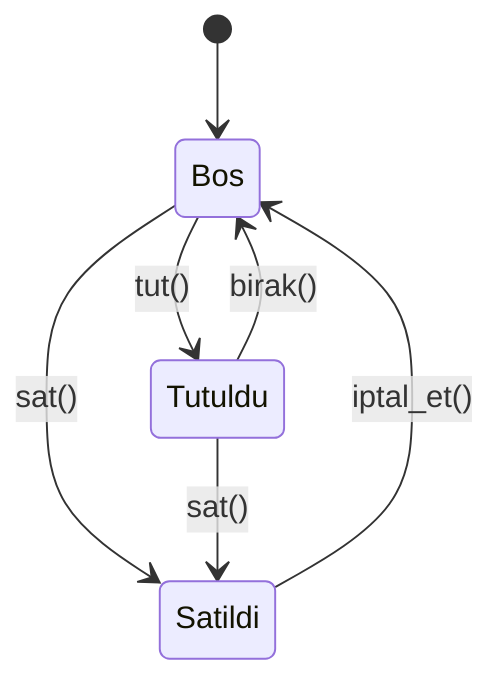
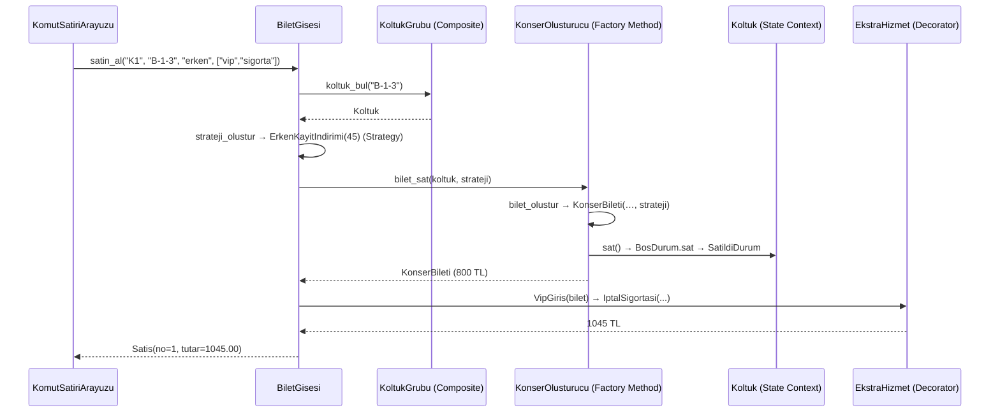
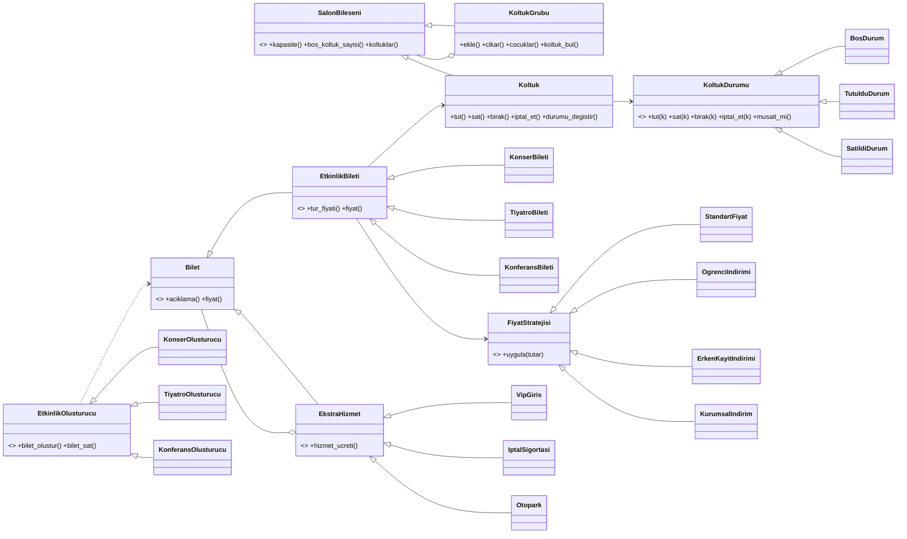

# Tasarım Dokümanı ve Kalıp Haritası

Bu doküman sistemin **nasıl** kurulduğunu anlatır: katmanlar, beş tasarım kalıbı, her
kalıbın rolleri ve dosyaları, değerlendirilen alternatif ve seçilen çözümün bedeli.
Davranış kuralları için [GEREKSINIMLER.md](GEREKSINIMLER.md).

## 1. Katmanlar

```
main.py                         giriş noktası (menü / --demo / --kaliplar)
└── bilet_sistemi/arayuz/       menülü arayüz, koltuk haritası, demolar        (kalıp yok)
    └── bilet_sistemi/uygulama/ BiletGisesi, Etkinlik, Satis, örnek veri         (kalıp yok)
        ├── salon/              Composite  (+ State'in Context'i: Koltuk)
        ├── durum/              State
        ├── etkinlik/           Factory Method  (+ Strategy'nin Context'i: EtkinlikBileti)
        ├── fiyat/              Strategy
        └── ekstra/             Decorator
```

Bağımlılıklar yalnızca yukarıdan aşağıya doğrudur. Kalıp paketleri arayüzü ve uygulama
katmanını bilmez. `hatalar.py` ortak hataları, `para.py` Decimal yuvarlamayı tutar.

## 2. Kalıp haritası (özet)

| Kalıp | Grup | Çözdüğü problem | Rol → Sınıf → Dosya (`bilet_sistemi/` altında) |
| --- | --- | --- | --- |
| Factory Method | Yaratımsal | Etkinlik türüne göre farklı bilet üretmek | Product → `Bilet` → `etkinlik/bilet.py`<br>ConcreteProduct → `KonserBileti`, `TiyatroBileti`, `KonferansBileti` → `etkinlik/bilet.py`<br>Creator → `EtkinlikOlusturucu` → `etkinlik/olusturucu.py`<br>ConcreteCreator → `KonserOlusturucu`, `TiyatroOlusturucu`, `KonferansOlusturucu` → `etkinlik/olusturucu.py` |
| Composite | Yapısal | Salon ağacını tek arayüzle sorgulamak | Component → `SalonBileseni` → `salon/bilesen.py`<br>Leaf → `Koltuk` → `salon/koltuk.py`<br>Composite → `KoltukGrubu` → `salon/koltuk_grubu.py` |
| Decorator | Yapısal | Bağımsız ekstraları bilete eklemek | Component → `Bilet` → `etkinlik/bilet.py`<br>ConcreteComponent → somut bilet sınıfları → `etkinlik/bilet.py`<br>Decorator → `EkstraHizmet` → `ekstra/hizmet.py`<br>ConcreteDecorator → `VipGiris`, `IptalSigortasi`, `Otopark` → `ekstra/hizmet.py` |
| Strategy | Davranışsal | Değiştirilebilir fiyat kuralları | Strategy → `FiyatStratejisi` → `fiyat/strateji.py`<br>ConcreteStrategy → `StandartFiyat`, `OgrenciIndirimi`, `ErkenKayitIndirimi`, `KurumsalIndirim` → `fiyat/strateji.py`<br>Context → `EtkinlikBileti` → `etkinlik/bilet.py` |
| State | Davranışsal | Duruma bağlı koltuk işlemleri | State → `KoltukDurumu` → `durum/koltuk_durumu.py`<br>ConcreteState → `BosDurum`, `TutulduDurum`, `SatildiDurum` → `durum/durumlar.py`<br>Context → `Koltuk` → `salon/koltuk.py` |

Dile gömülü kısayol (lambda yerine strateji, desen eşleme yerine visitor vb.) **hiçbir
kalıpta kullanılmamıştır**; her rol bir sınıftır. Çerçeve kalıbı kullanılmamıştır.
`BiletGisesi` içindeki `TARIFELER` sözlüğündeki lambdalar yalnızca menü kodunu bir
strateji **nesnesine** çevirir; Strategy rolünü üstlenmez.

## 3. Kalıplar

### 3.1 State: koltuk durumları

**Problem.** Koltukta yapılabilecek işlemler (tut, sat, bırak, iptal) durumuna göre değişir.
Kalıpsız çözümde `Koltuk` içinde dört metodun her birinde üç dallı bir `if/elif` olur (12 dal);
yeni bir durum eklemek dört metodu birden değiştirir.

**Çözüm.** Her durum `KoltukDurumu` arayüzünü uygulayan bir sınıftır ve o durumda hangi
işlemin yapılabileceğini kendisi bilir. `Koltuk` işi o anki durum nesnesine devreder
(`self._durum.tut(self)`); izin verilen işlem `koltuk.durumu_degistir(YeniDurum())` ile geçiş
yapar, izin verilmeyen `GecersizIslemHatasi` fırlatır. Üç durum birbirini oluşturduğu için
döngüsel içe aktarmayı önlemek amacıyla aynı dosyadadır (`durum/durumlar.py`).



**Alternatif.** Durumu bir `str` / `Enum` alanında tutup `Koltuk` metotlarında `if/elif`.
**Bedel.** Daha fazla sınıf (1 arayüz + 3 durum); geçişler birden fazla dosyaya dağılır ve
durum nesneleri `Koltuk`'un `durumu_degistir` metodunu bilmek zorundadır.

### 3.2 Composite: salon ağacı

**Problem.** "Kaç boş koltuk var?" sorusu bazen salona, bazen bloğa, bazen sıraya sorulur.
Kalıpsız çözümde her seviye için iç içe döngüler ve tip kontrolleri gerekir; yeni bir seviye
(loca) bütün döngüleri değiştirir.

**Çözüm.** `Koltuk` (Leaf) ve `KoltukGrubu` (Composite) aynı `SalonBileseni` arayüzünü
uygular. Grup hesap yapmaz; çocuklarına sorup toplar:
`sum(c.bos_koltuk_sayisi() for c in self._cocuklar)`. Salon, blok ve sıra davranışları aynı
olduğu için ayrı sınıflar değil, `tur` alanı farklı `KoltukGrubu` nesneleridir.

**Alternatif.** `Salon`, `Blok`, `Sira` için ayrı sınıflar ve her birinde ayrı döngü.
**Bedel.** Yaprak ile grup arasındaki fark arayüzde gizlenir: `ekle` / `cikar` yalnızca
`KoltukGrubu`'nda vardır (güvenli Composite tercihi); istemci gruba ekleme yapmak için
gerçek türü bilmelidir. Her sorgu ağacın tamamını gezer (bu boyutta önemsiz).

### 3.3 Factory Method: etkinlik türüne göre bilet

**Problem.** Konser, tiyatro ve konferans biletlerinin fiyat kuralı ve açıklaması farklı.
Kalıpsız çözümde bilet oluşturulan her yerde `if tur == "konser": ...` zinciri olur; yeni
etkinlik türü bütün zincirleri değiştirir.

**Çözüm.** `EtkinlikOlusturucu.bilet_sat()` ortak satış adımını yürütür (bileti üret,
koltuğu sat, bileti döndür) ama hangi bileti üreteceğini bilmez; bu kararı alt sınıfların
yazdığı soyut `bilet_olustur()` fabrika metoduna bırakır. `KonserOlusturucu` → `KonserBileti`,
vb. Satış kodu yalnızca `Bilet` arayüzünü görür.

**Alternatif.** Tek bir `BiletFabrikasi.olustur(tur)` içinde `if/elif` (Simple Factory) veya
istemcide doğrudan `KonserBileti(...)`.
**Bedel.** Her yeni bilet türü için iki sınıf (ürün + oluşturucu) yazılır; paralel sınıf
hiyerarşisi oluşur.

### 3.4 Strategy: fiyat kuralları

**Problem.** Öğrenci, erken kayıt ve kurumsal indirimleri ayrı algoritmalardır ve satış
anında seçilir. Kalıpsız çözümde `fiyat()` içinde `if musteri == ...` zinciri olur; yeni
indirim bilet sınıfını değiştirir.

**Çözüm.** Her kural `FiyatStratejisi.uygula(tutar)` yöntemini uygulayan bir sınıftır.
`EtkinlikBileti` (Context) stratejiyi bir alanda tutar ve
`fiyat() = yuvarla(strateji.uygula(tur_fiyati()))` hesaplar. Strateji verilmezse
`StandartFiyat` kullanılır; strateji çalışma anında değiştirilebilir. Somut biletler yalnızca
`tur_fiyati()` yazar; indirim tek yerde uygulanır.

**Alternatif.** Tarife kodunu bilette tutup `fiyat()` içinde `if/elif`; veya her tarife için
bilet alt sınıfı (`OgrenciKonserBileti` ...).
**Bedel.** İstemci (gişe) hangi stratejiyi seçeceğini bilmek zorundadır; `ErkenKayitIndirimi`
gibi bağlama ihtiyaç duyan stratejiler veriyi (kalan gün) yapıcıdan alır.

### 3.5 Decorator: ekstra hizmetler

**Problem.** VIP giriş, otopark ve iptal sigortası birbirinden bağımsızdır, istenen sayıda ve
sırada eklenebilir. Kalıtımla her kombinasyon için sınıf gerekir
(`KonserBiletiVipOtopark`...): "sınıf patlaması".

**Çözüm.** `EkstraHizmet` hem `Bilet`'tir hem içinde bir `Bilet` tutar. `aciklama()` ve
`fiyat()` isteklerini içteki bilete iletir, kendi katkısını ekler:
`fiyat() = yuvarla(self._bilet.fiyat() + self.hizmet_ucreti())`. Kullanım:
`IptalSigortasi(Otopark(VipGiris(bilet)))`.

**Alternatif.** Bilette `ekstralar: list` alanı ve fiyat hesabında döngü; veya her
kombinasyon için alt sınıf.
**Bedel.** Sarma sırası sonucu değiştirir (sigorta en dışta önceki ekstraları da sigortalar:
715 TL, içte 700 TL). Sarılmış nesne yalnızca `Bilet` arayüzünü sunar; `koltuk` gibi somut
bilet alanlarına ulaşılamaz. Bu yüzden `Satis` kaydı koltuğu ayrıca tutar.

## 4. Kalıpların birlikte çalışması: bilet satın alma



## 5. Sınıf diyagramı



## 6. Değişikliğe uyum

| Olası değişiklik | Kalıp | Eklenen | Değişen |
| --- | --- | --- | --- |
| Yeni etkinlik türü (spor müsabakası) | Factory Method | `SporBileti`, `SporOlusturucu` | yok (örnek veriye etkinlik eklenir) |
| Yeni indirim (grup indirimi) | Strategy | `GrupIndirimi` | `TARIFELER`'e bir satır |
| Yeni ekstra (yiyecek paketi) | Decorator | `YiyecekPaketi` | `EKSTRALAR`'a bir satır |
| Tutulan koltuk süre sonunda serbest kalsın | State | (gerekirse) süreli durum sınıfı | `TutulduDurum` |
| Yeni salon düzeni (loca, ayakta alan) | Composite | yok | yalnızca salon kurulumu |

## 7. Kalıp dışı sınıflar

| Sınıf / dosya | Görevi |
| --- | --- |
| `EtkinlikBileti` | Somut biletlerin ortak verisi; aynı zamanda Strategy'nin Context'i. |
| `salon/duzen.py` → `salon_olustur` | Salon ağacını tek çağrıyla kuran yardımcı fonksiyon. |
| `para.py` → `yuvarla` | Decimal tutarı iki basamağa yuvarlar. |
| `uygulama/` → `Etkinlik`, `Satis`, `BiletGisesi`, `ornek_gise` | Kalıpları bir araya getiren servis ve veri sınıfları. |
| `arayuz/` → `KomutSatiriArayuzu`, `koltuk_haritasi`, demolar | Kullanıcı arayüzü. |
