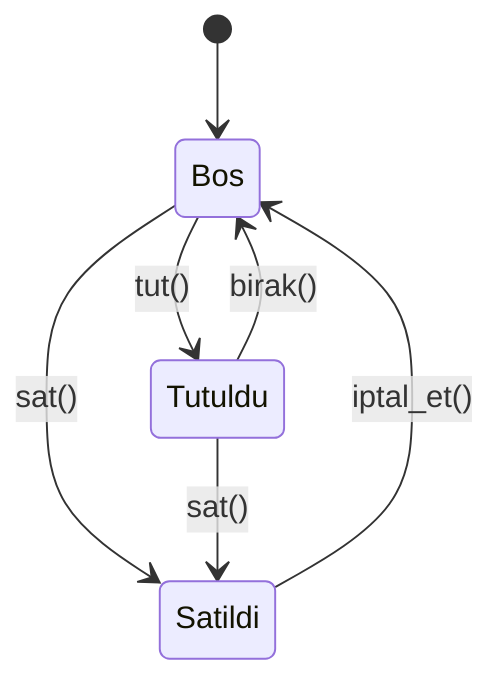
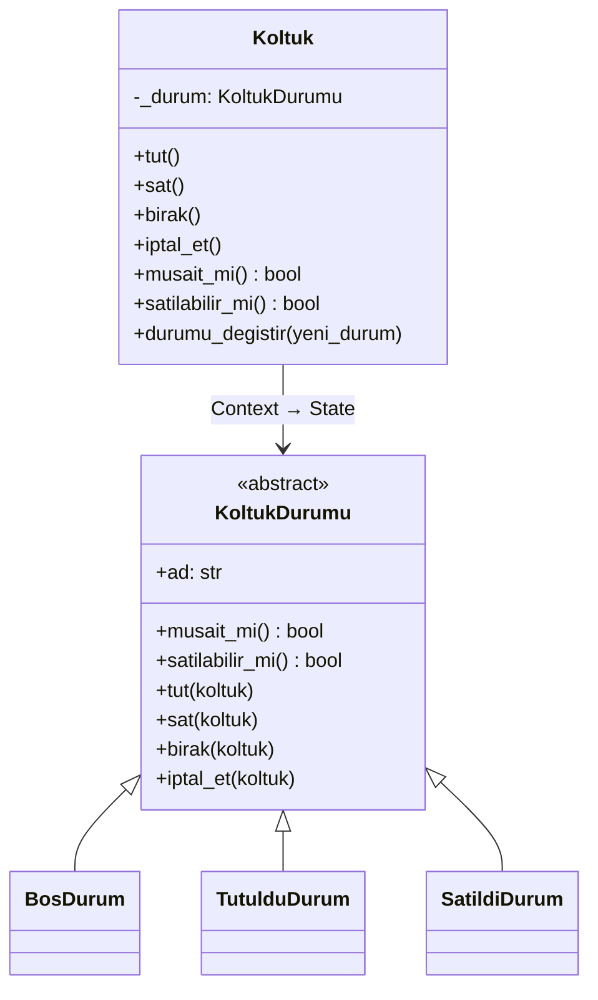
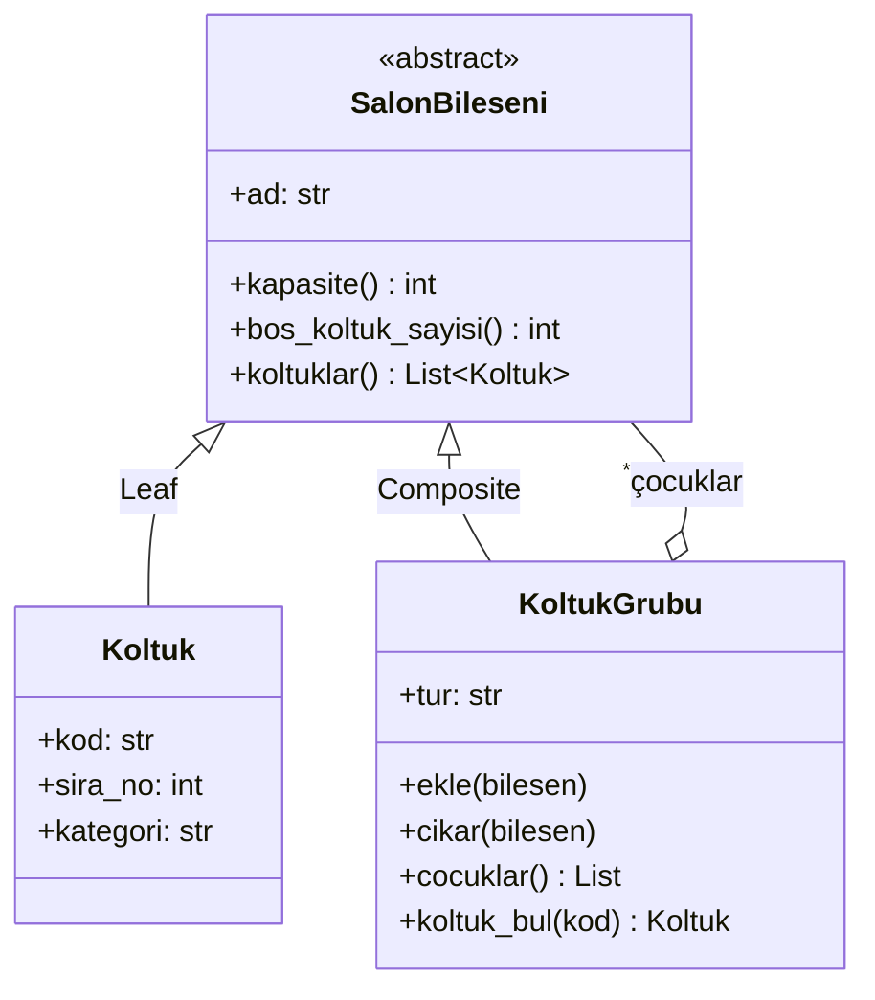
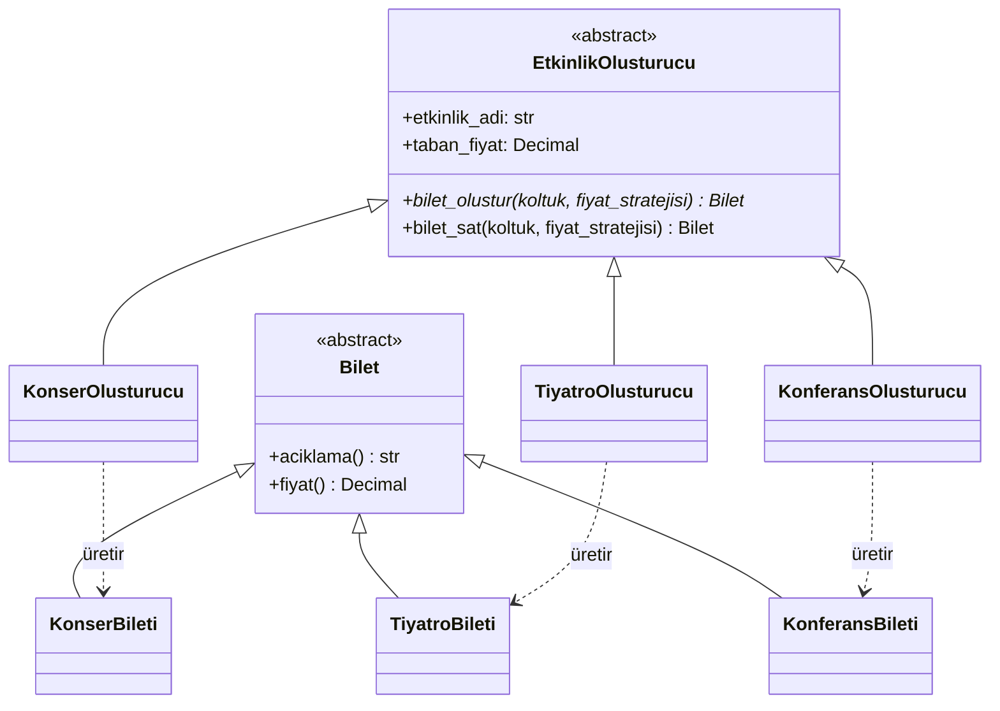
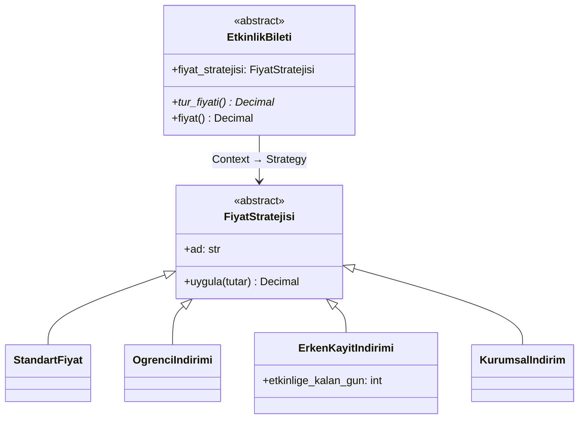
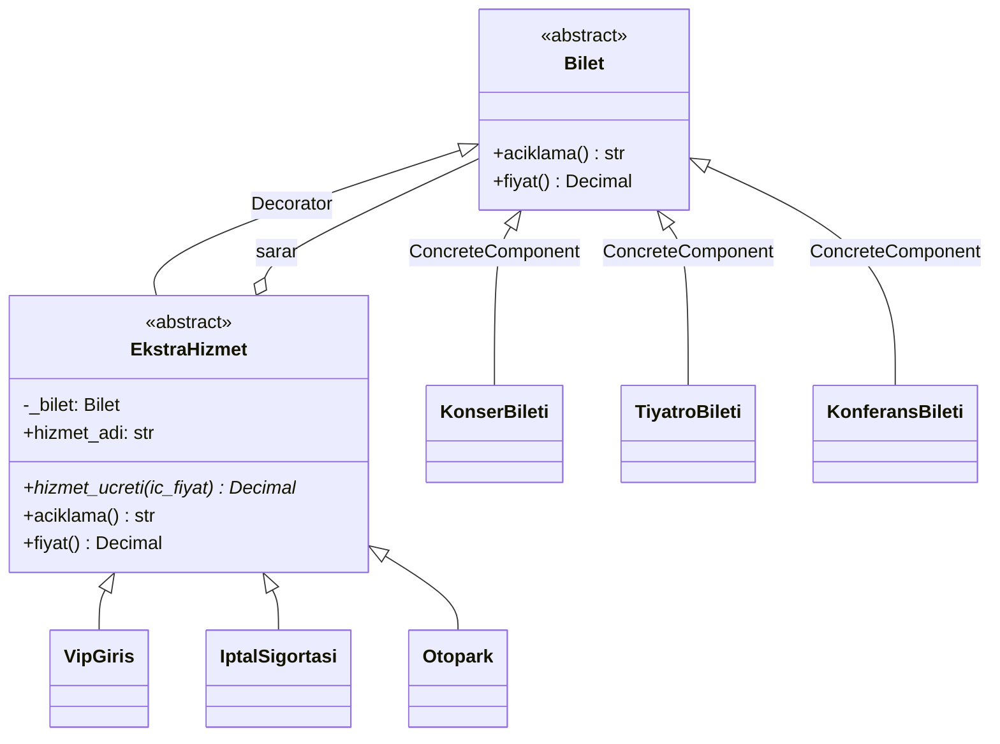
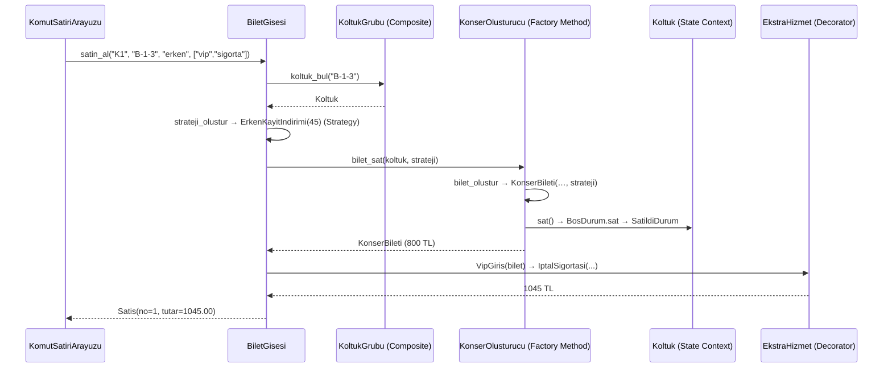
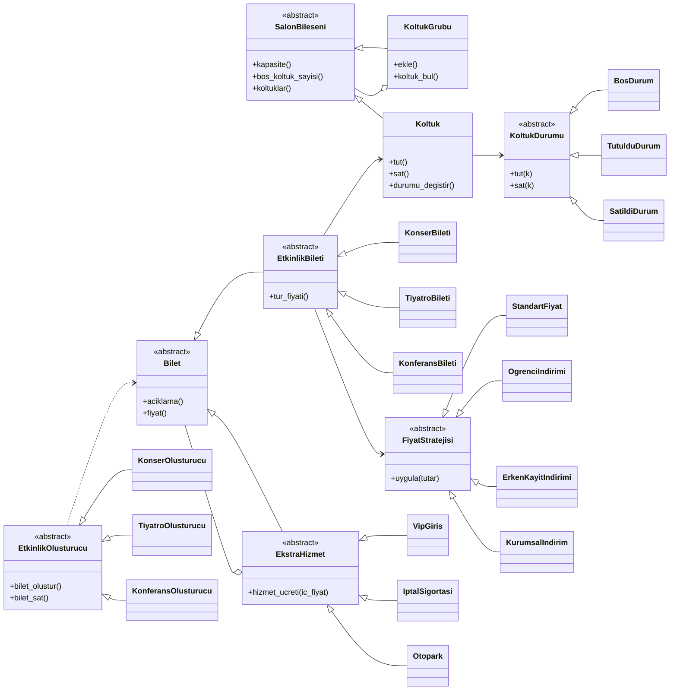

# Tasarım Dokümanı ve Kalıp Haritası

Bu doküman sistemin **nasıl** kurulduğunu anlatır: katmanlar, beş tasarım kalıbı, her
kalıbın rolleri, dosyaları ve UML sınıf diyagramı, değerlendirilen alternatif, seçilen
çözümün bedeli, kapsam değişiklikleri kaydı ve bütün genel sınıfların imzaları (bölüm 9).
Davranış kuralları için [GEREKSINIMLER.md](GEREKSINIMLER.md).

## 1. Katmanlar

```
main.py                         giriş noktası (menü / --demo / --kaliplar)
└── bilet_sistemi/arayuz/       menülü arayüz, koltuk haritası, demolar        (kalıp yok)
    └── bilet_sistemi/uygulama/ BiletGisesi, Etkinlik, Satis, örnek veri         (kalıp yok)
        ├── salon/              Composite  (+ State'in Context'i: Koltuk)
        ├── durum/              State
        ├── etkinlik/           Factory Method  (+ Strategy'nin Context'i: EtkinlikBileti)
        ├── fiyat/              Strategy
        └── ekstra/             Decorator
```

Bağımlılıklar yalnızca yukarıdan aşağıya doğrudur. Kalıp paketleri arayüzü ve uygulama
katmanını bilmez. `hatalar.py` ortak hataları, `para.py` Decimal yuvarlamayı tutar.

## 2. Kalıp haritası (özet)

| Kalıp | Grup | Çözdüğü problem | Rol → Sınıf → Dosya (`bilet_sistemi/` altında) |
| --- | --- | --- | --- |
| Factory Method | Yaratımsal | Etkinlik türüne göre farklı bilet üretmek | Product → `Bilet` → `etkinlik/bilet.py`<br>ConcreteProduct → `KonserBileti`, `TiyatroBileti`, `KonferansBileti` → `etkinlik/bilet.py`<br>Creator → `EtkinlikOlusturucu` → `etkinlik/olusturucu.py`<br>ConcreteCreator → `KonserOlusturucu`, `TiyatroOlusturucu`, `KonferansOlusturucu` → `etkinlik/olusturucu.py` |
| Composite | Yapısal | Salon ağacını tek arayüzle sorgulamak | Component → `SalonBileseni` → `salon/bilesen.py`<br>Leaf → `Koltuk` → `salon/koltuk.py`<br>Composite → `KoltukGrubu` → `salon/koltuk_grubu.py` |
| Decorator | Yapısal | Bağımsız ekstraları bilete eklemek | Component → `Bilet` → `etkinlik/bilet.py`<br>ConcreteComponent → `KonserBileti`, `TiyatroBileti`, `KonferansBileti` → `etkinlik/bilet.py`<br>Decorator → `EkstraHizmet` → `ekstra/hizmet.py`<br>ConcreteDecorator → `VipGiris`, `IptalSigortasi`, `Otopark` → `ekstra/hizmet.py` |
| Strategy | Davranışsal | Değiştirilebilir fiyat kuralları | Strategy → `FiyatStratejisi` → `fiyat/strateji.py`<br>ConcreteStrategy → `StandartFiyat`, `OgrenciIndirimi`, `ErkenKayitIndirimi`, `KurumsalIndirim` → `fiyat/strateji.py`<br>Context → `EtkinlikBileti` → `etkinlik/bilet.py` |
| State | Davranışsal | Duruma bağlı koltuk işlemleri | State → `KoltukDurumu` → `durum/koltuk_durumu.py`<br>ConcreteState → `BosDurum`, `TutulduDurum`, `SatildiDurum` → `durum/durumlar.py`<br>Context → `Koltuk` → `salon/koltuk.py` |

Dile gömülü kısayol (lambda yerine strateji, desen eşleme yerine visitor vb.) **hiçbir
kalıpta kullanılmamıştır**; her rol bir sınıftır. Çerçeve kalıbı kullanılmamıştır.
`uygulama/gise.py` modülündeki `TARIFELER` sözlüğünün lambdaları yalnızca menü kodunu bir
strateji **nesnesine** çevirir; Strategy rolünü üstlenmez.
`EtkinlikBileti.fiyat()` içinde alt sınıfın `tur_fiyati()` adımını çağırmak bir Template
Method benzeridir; ayrı bir kalıp olarak sayılmamıştır.

## 3. Kalıplar

### 3.1 State: koltuk durumları

**Problem.** Koltukta yapılabilecek işlemler (tut, sat, bırak, iptal) durumuna göre değişir.
Kalıpsız çözümde `Koltuk` içinde dört metodun her birinde üç dallı bir `if/elif` olur (12 dal);
yeni bir durum eklemek dört metodu birden değiştirir.

**Çözüm.** Her durum `KoltukDurumu` arayüzünü uygulayan bir sınıftır ve o durumda hangi
işlemin yapılabileceğini kendisi bilir. `Koltuk` işi o anki durum nesnesine devreder
(`self._durum.tut(self)`); izin verilen işlem `koltuk.durumu_degistir(YeniDurum())` ile geçiş
yapar, izin verilmeyen `GecersizIslemHatasi` fırlatır. Üç durum birbirini oluşturduğu için
döngüsel içe aktarmayı önlemek amacıyla aynı dosyadadır (`durum/durumlar.py`).





**Alternatif.** Durumu bir `str` / `Enum` alanında tutup `Koltuk` metotlarında `if/elif`.
**Bedel.** Daha fazla sınıf (1 arayüz + 3 durum); geçişler birden fazla dosyaya dağılır ve
durum nesneleri `Koltuk`'un `durumu_degistir` metodunu bilmek zorundadır.

### 3.2 Composite: salon ağacı

**Problem.** "Kaç boş koltuk var?" sorusu bazen salona, bazen bloğa, bazen sıraya sorulur.
Kalıpsız çözümde her seviye için iç içe döngüler ve tip kontrolleri gerekir; yeni bir seviye
(loca) bütün döngüleri değiştirir.

**Çözüm.** `Koltuk` (Leaf) ve `KoltukGrubu` (Composite) aynı `SalonBileseni` arayüzünü
uygular. Grup hesap yapmaz; çocuklarına sorup toplar:
`sum(c.bos_koltuk_sayisi() for c in self._cocuklar)`. Salon, blok ve sıra davranışları aynı
olduğu için ayrı sınıflar değil, `tur` alanı farklı `KoltukGrubu` nesneleridir.



**Alternatif.** `Salon`, `Blok`, `Sira` için ayrı sınıflar ve her birinde ayrı döngü.
**Bedel.** "Güvenli" Composite seçildi: `ekle` / `cikar` yalnızca `KoltukGrubu`'nda vardır,
bu yüzden yaprak ile grup arasındaki fark istemciye **açıktır**; gruba ekleme yapan veya
ağacı çizen kod (`arayuz/gorunum.py`) gerçek türü (`isinstance`) bilmek zorundadır.
Harita çizimi ve `salon_olustur` üç seviyeli (blok → sıra → koltuk) düzeni varsayar.
Her sorgu ağacın tamamını gezer (bu boyutta önemsiz). Ağacın bozulmasını önlemek için
`ekle` bir grubun kendi içine veya aynı bileşenin iki kez eklenmesini reddeder.

### 3.3 Factory Method: etkinlik türüne göre bilet

**Problem.** Konser, tiyatro ve konferans biletlerinin fiyat kuralı ve açıklaması farklı.
Kalıpsız çözümde bilet oluşturulan her yerde `if tur == "konser": ...` zinciri olur; yeni
etkinlik türü bütün zincirleri değiştirir.

**Çözüm.** `EtkinlikOlusturucu.bilet_sat()` ortak satış adımını yürütür (bileti üret,
koltuğu sat, bileti döndür) ama hangi bileti üreteceğini bilmez; bu kararı alt sınıfların
yazdığı soyut `bilet_olustur()` fabrika metoduna bırakır. `KonserOlusturucu` → `KonserBileti`,
vb. Satış kodu yalnızca `Bilet` arayüzünü görür.



(Somut biletler aradaki `EtkinlikBileti` sınıfından türer; diyagramı sade tutmak için gösterilmedi.)

**Alternatif.** Tek bir `BiletFabrikasi.olustur(tur)` içinde `if/elif` (Simple Factory) veya
istemcide doğrudan `KonserBileti(...)`.
**Bedel.** Her yeni bilet türü için iki sınıf (ürün + oluşturucu) yazılır; paralel sınıf
hiyerarşisi oluşur. Somut oluşturucular şu an yalnızca doğru ürünü kurar; türe özgü satış
adımları (ör. konserde yaş kontrolü) gerekirse oluşturucunun içine eklenir. Etkinlik adı ve
taban fiyat hem `Etkinlik`'te hem oluşturucuda tutulur (örnek veride ikisi aynı verilir).

### 3.4 Strategy: fiyat kuralları

**Problem.** Öğrenci, erken kayıt ve kurumsal indirimleri ayrı algoritmalardır ve satış
anında seçilir. Kalıpsız çözümde `fiyat()` içinde `if musteri == ...` zinciri olur; yeni
indirim bilet sınıfını değiştirir.

**Çözüm.** Her kural `FiyatStratejisi.uygula(tutar)` yöntemini uygulayan bir sınıftır.
`EtkinlikBileti` (Context) stratejiyi bir alanda tutar ve
`fiyat() = yuvarla(strateji.uygula(tur_fiyati()))` hesaplar. Strateji verilmezse
`StandartFiyat` kullanılır; strateji çalışma anında değiştirilebilir. Somut biletler yalnızca
`tur_fiyati()` yazar; indirim tek yerde uygulanır.



**Alternatif.** Tarife kodunu bilette tutup `fiyat()` içinde `if/elif`; veya her tarife için
bilet alt sınıfı (`OgrenciKonserBileti` ...).
**Bedel.** İstemci (gişe) hangi stratejiyi seçeceğini bilmek zorundadır; `ErkenKayitIndirimi`
gibi bağlama ihtiyaç duyan stratejiler veriyi (kalan gün) yapıcıdan alır.

### 3.5 Decorator: ekstra hizmetler

**Problem.** VIP giriş, otopark ve iptal sigortası birbirinden bağımsızdır, istenen sayıda ve
sırada eklenebilir. Kalıtımla her kombinasyon için sınıf gerekir
(`KonserBiletiVipOtopark`...): "sınıf patlaması".

**Çözüm.** `EkstraHizmet` hem `Bilet`'tir hem içinde bir `Bilet` tutar. `aciklama()` ve
`fiyat()` isteklerini içteki bilete iletir, kendi katkısını ekler. İçteki fiyat bir kez
hesaplanıp hizmete verilir: `ic = self._bilet.fiyat(); return yuvarla(ic + self.hizmet_ucreti(ic))`
(her katman içtekini bir kez sorar; iç içe sigortada hesap üstel büyümez). Kullanım:
`IptalSigortasi(Otopark(VipGiris(bilet)))`.



**Alternatif.** Bilette `ekstralar: list` alanı ve fiyat hesabında döngü; veya her
kombinasyon için alt sınıf.
**Bedel.** Sarma sırası sonucu değiştirir (sigorta en dışta önceki ekstraları da sigortalar:
715 TL, içte 700 TL). Sarılmış nesne yalnızca `Bilet` arayüzünü sunar; `koltuk` gibi somut
bilet alanlarına ulaşılamaz. Bu yüzden `Satis` kaydı koltuğu ayrıca tutar.

## 4. Kalıpların birlikte çalışması: bilet satın alma



## 5. Bütün sistemin sınıf diyagramı



## 6. Değişikliğe uyum

| Olası değişiklik | Kalıp | Eklenen | Değişen |
| --- | --- | --- | --- |
| Yeni etkinlik türü (spor müsabakası) | Factory Method | `SporBileti`, `SporOlusturucu` | yok (örnek veriye etkinlik eklenir) |
| Yeni indirim (grup indirimi) | Strategy | `GrupIndirimi` | `TARIFELER`'e bir satır |
| Yeni ekstra (yiyecek paketi) | Decorator | `YiyecekPaketi` | `EKSTRALAR`'a bir satır |
| Tutulan koltuk süre sonunda serbest kalsın | State | (gerekirse) süreli durum sınıfı | `TutulduDurum` |
| Yeni salon düzeni (loca) | Composite | yok | salon kurulumu; dört seviyeli bir düzen için `salon_olustur` ve `arayuz/gorunum.py` |
| Ayakta alan (numarasız kapasite) | Composite | yeni bir Leaf sınıfı (`AyaktaAlan`) | `arayuz/gorunum.py` (harita çizimi) |

## 7. Kapsam değişiklikleri kaydı

Ders kuralına göre öğretim üyesi dönem içinde kapsam veya kural değişikliği açıklayabilir;
her değişiklik bir hafta içinde karşılanır, Git'te etiketlenir ve buraya işlenir.

**Bu dönem kapsam değişikliği duyurulmadı.** Olası değişikliklerin hangi kalıpla ve hangi
sınıflarla karşılanacağı bölüm 6'daki "Değişikliğe uyum" tablosunda gösterilmiştir.

Değerlendirme sonrası yapılan iyileştirmeler (değişiklik kaydı değildir): satış tutarının
satış anında sabitlenmesi, Decorator'da iç fiyatın bir kez hesaplanması, `satilabilir_mi`
durumu, geçmiş etkinliğe satış engeli, Composite ağaç koruması.

## 8. Kalıp dışı sınıflar

| Sınıf / dosya | Görevi |
| --- | --- |
| `EtkinlikBileti` | Somut biletlerin ortak verisi; aynı zamanda Strategy'nin Context'i. |
| `salon/duzen.py` → `salon_olustur` | Salon ağacını tek çağrıyla kuran yardımcı fonksiyon. |
| `para.py` → `yuvarla` | Decimal tutarı iki basamağa yuvarlar. |
| `uygulama/` → `Etkinlik`, `Satis`, `BiletGisesi`, `ornek_gise` | Kalıpları bir araya getiren servis ve veri sınıfları. |
| `arayuz/` → `KomutSatiriArayuzu`, `koltuk_haritasi`, demolar | Kullanıcı arayüzü. |

## 9. API özeti

Bütün genel sınıflar, fonksiyonlar ve imzaları. Tutarlar `Decimal`, tarihler `datetime.date`.
Bütün fiyat sabitleri (`UCRET`, `ORAN`, `*_CARPANI`) `Decimal`'dir ve sınıf özniteliği olarak
**hesap anında** okunur (sınıfta değiştirilirse sonraki hesaplar yeni değeri kullanır;
sabitlenmiş `Satis.tutar` değişmez). `taban_fiyat` her zaman `Decimal` verilir.
Modül yolları `bilet_sistemi/` altındadır; her alt paket `__init__.py` içinde bu adları dışa aktarır
(ör. `from bilet_sistemi.salon import Koltuk`).

| Modül | Ad | İmza / alanlar |
| --- | --- | --- |
| `hatalar` | `BiletSistemiHatasi(Exception)` | Ortak ata. Alt sınıflar: `GecersizIslemHatasi`, `BulunamadiHatasi`, `GecersizSecimHatasi` |
| `para` | `yuvarla` | `yuvarla(tutar: Decimal) -> Decimal` (2 basamak, ROUND_HALF_UP) |
| `durum.koltuk_durumu` | `KoltukDurumu(ABC)` | `ad: str` (özellik), `musait_mi() -> bool`, `satilabilir_mi() -> bool`, `tut(koltuk)`, `sat(koltuk)`, `birak(koltuk)`, `iptal_et(koltuk)` |
| `durum.durumlar` | `BosDurum`, `TutulduDurum`, `SatildiDurum` | `KoltukDurumu`'nu uygular; `ad`: `"Boş"`, `"Tutuldu"`, `"Satıldı"` |
| `salon.bilesen` | `SalonBileseni(ABC)` | `ad: str` (özellik), `kapasite() -> int`, `bos_koltuk_sayisi() -> int`, `koltuklar() -> List[Koltuk]` |
| `salon.koltuk` | `Koltuk(SalonBileseni)` | `Koltuk(kod: str, sira_no: int, kategori: str = "standart")`; alanlar `kod`, `sira_no`, `kategori`; `ad` = `kod`; `durum_adi: str` (özellik); `musait_mi()`, `satilabilir_mi()`, `tut()`, `sat()`, `birak()`, `iptal_et()`, `durumu_degistir(yeni_durum)` |
| `salon.koltuk_grubu` | `KoltukGrubu(SalonBileseni)` | `KoltukGrubu(ad: str, tur: str)`; `ekle(bilesen)`, `cikar(bilesen)`, `cocuklar() -> List[SalonBileseni]` (kopya), `koltuk_bul(kod) -> Optional[Koltuk]` |
| `salon.duzen` | `salon_olustur` | `salon_olustur(ad: str, bloklar: Dict[str, Tuple[int, int]], vip_bloklar: Iterable[str] = ()) -> KoltukGrubu` |
| `etkinlik.bilet` | `Bilet(ABC)` | `aciklama() -> str`, `fiyat() -> Decimal` |
| `etkinlik.bilet` | `EtkinlikBileti(Bilet, ABC)` | `EtkinlikBileti(etkinlik_adi: str, koltuk: Koltuk, taban_fiyat: Decimal, fiyat_stratejisi: Optional[FiyatStratejisi] = None)`; alanlar `etkinlik_adi`, `koltuk`, `taban_fiyat`, `fiyat_stratejisi` (yazılabilir; `None` → `StandartFiyat()`); soyut `tur_fiyati() -> Decimal`; `fiyat() = yuvarla(fiyat_stratejisi.uygula(tur_fiyati()))` |
| `etkinlik.bilet` | `KonserBileti`, `TiyatroBileti`, `KonferansBileti` | `EtkinlikBileti`'nden türer; sabitler: `KonserBileti.VIP_CARPANI = 2.0`, `TiyatroBileti.ON_SIRA_SINIRI = 3`, `TiyatroBileti.ON_SIRA_CARPANI = 1.25` |
| `etkinlik.olusturucu` | `EtkinlikOlusturucu(ABC)` | `EtkinlikOlusturucu(etkinlik_adi: str, taban_fiyat: Decimal)`; soyut `bilet_olustur(koltuk, fiyat_stratejisi=None) -> Bilet`; `bilet_sat(koltuk, fiyat_stratejisi=None) -> Bilet` (önce `bilet_olustur`, sonra `koltuk.sat()`) |
| `etkinlik.olusturucu` | `KonserOlusturucu`, `TiyatroOlusturucu`, `KonferansOlusturucu` | Yalnızca `bilet_olustur`'u yazar |
| `fiyat.strateji` | `FiyatStratejisi(ABC)` | `ad: str` (özellik), `uygula(tutar: Decimal) -> Decimal` |
| `fiyat.strateji` | `StandartFiyat`, `OgrenciIndirimi`, `ErkenKayitIndirimi`, `KurumsalIndirim` | `ErkenKayitIndirimi(etkinlige_kalan_gun: int)`; sabitler `ORAN` (0.30, 0.20, 0.15), `ErkenKayitIndirimi.GEREKEN_GUN = 30` |
| `ekstra.hizmet` | `EkstraHizmet(Bilet)` | `EkstraHizmet(bilet: Bilet)`; soyut `hizmet_adi: str` (özellik), soyut `hizmet_ucreti(ic_fiyat: Decimal) -> Decimal`; `aciklama()` = iç açıklama + ` + {hizmet_adi}` |
| `ekstra.hizmet` | `VipGiris`, `IptalSigortasi`, `Otopark` | Sabitler `VipGiris.UCRET = 150`, `Otopark.UCRET = 75`, `IptalSigortasi.ORAN = 0.10` |
| `uygulama.etkinlik` | `Etkinlik` (dataclass) | `Etkinlik(kod, ad, tur, tarih: date, salon: KoltukGrubu, olusturucu: EtkinlikOlusturucu)`; `kalan_gun(bugun: date) -> int` |
| `uygulama.satis` | `Satis` (dataclass) | `Satis(no: int, etkinlik, koltuk, bilet: Bilet, tutar: Decimal, tarife: str, ekstralar: List[str] = [], iptal_edildi: bool = False)` |
| `uygulama.gise` | `TARIFELER` | `OrderedDict[kod, (menü_adı, Callable[[Etkinlik, date], FiyatStratejisi])]`, K4 sırasıyla |
| `uygulama.gise` | `EKSTRALAR` | `OrderedDict[kod, (menü_adı, Type[EkstraHizmet])]`, K5 sırasıyla |
| `uygulama.gise` | `BiletGisesi` | `BiletGisesi(etkinlikler: Sequence[Etkinlik], bugun: Optional[date] = None)`; `bugun` (özellik: verilen tarih, verilmediyse `date.today()`); `etkinlikler()`, `etkinlik_bul(kod)`, `koltuk_bul(etkinlik_kodu, koltuk_kodu)`, `satislar(iptaller_dahil=False)`, `satis_bul(no)`, `strateji_olustur(etkinlik, tarife)`, `ekstralari_dogrula(ekstralar)`, `ekstralari_ekle(bilet, ekstralar) -> Bilet`, `fiyat_teklifi(etkinlik_kodu, koltuk_kodu, tarife="standart", ekstralar=()) -> Bilet`, `satin_al(...) -> Satis` (aynı parametreler), `koltuk_tut(...) -> Koltuk`, `koltuk_birak(...) -> Koltuk`, `satis_iptal(no) -> Satis`, `toplam_ciro() -> Decimal`, `etkinlik_ozeti() -> List[Tuple[Etkinlik, int, Decimal]]` |
| `uygulama.ornek_veri` | `ornek_gise` | `ornek_gise(bugun: Optional[date] = None) -> BiletGisesi` |
| `arayuz.cli` | `KomutSatiriArayuzu` | `KomutSatiriArayuzu(gise, girdi: Callable[[str], str] = input, cikti: Callable[[str], None] = print)`; `calistir()` |
| `arayuz.cli` | `senaryo_girdisi` | `senaryo_girdisi(adimlar: Iterable[str], cikti=print) -> girdi`: dönen `girdi(soru)` cevapları sırayla verir, her seferinde `cikti(soru + cevap)` çağırır, cevaplar bitince `EOFError` fırlatır |
| `arayuz.gorunum` | `koltuk_haritasi` | `koltuk_haritasi(salon: KoltukGrubu) -> str` |
| `arayuz.demo` | `KULLANICI_SENARYOSU`, `kullanici_demosu`, `kalip_turu` | `kullanici_demosu(cikti=print, bugun: Optional[date] = None)`, `kalip_turu(cikti=print)` |
| `main.py` | `main()` | `--demo` ve `--kaliplar` seçenekleri (birbirini dışlar); seçeneksiz menü |
